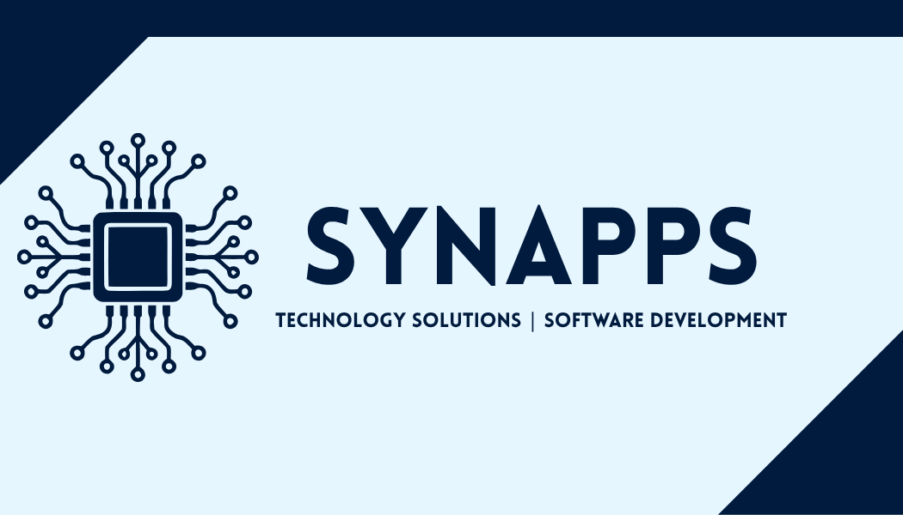
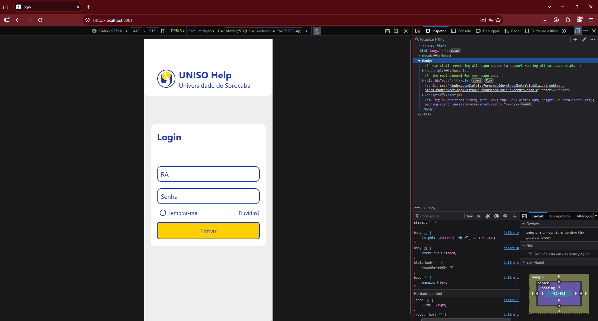
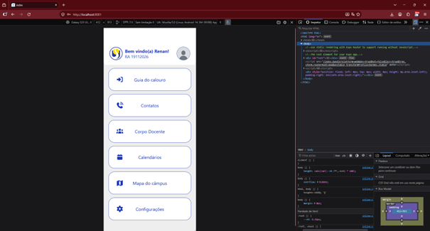

 <p align="center">
  
</p>

<h1 align="center">UNISO Help</h1>

<p align="center">
  <strong>Uma plataforma de apoio acadêmico para os estudantes da Universidade de Sorocaba (UNISO).</strong>
</p>

---

## 🎯 Objetivos

<p align="justify">
O UNISO Help é um projeto acadêmico desenvolvido pela equipe <strong>Synapps</strong>, com o objetivo de centralizar informações, orientações e serviços institucionais em uma interface intuitiva, facilitando a adaptação dos novos alunos e o acesso às ferramentas utilizadas no cotidiano universitário.
</p>

<p align="justify">
A proposta é reduzir as dificuldades na localização de informações acadêmicas e administrativas, oferecendo acesso rápido a tutoriais, contatos institucionais, calendários e outros recursos relevantes para a comunidade estudantil.
</p>

- Facilitar a integração dos calouros ao ambiente universitário.
- Centralizar links, orientações e informações institucionais.
- Simplificar o acesso aos canais de atendimento da universidade.
- Melhorar a acessibilidade e a experiência de navegação dos estudantes.
- Contribuir para a permanência estudantil por meio de informações mais acessíveis e organizadas.

## ✨ Funcionalidades previstas

- **Login:** interface de acesso do usuário ao aplicativo.
- **Guia do Calouro:** orientações para acessar o aplicativo do aluno, o UNISO Virtual, a rede Wi-Fi, os laboratórios, as bibliotecas e outros recursos acadêmicos.
- **Atendimento:** consulta aos contatos dos setores e serviços da universidade.
- **Corpo Docente:** acesso às informações de contato de professores, coordenadores e ouvidoria.
- **Calendários Acadêmicos:** acesso aos calendários das modalidades presencial, EAD e stricto sensu.
- **Mapa da Universidade:** acesso ao mapa do campus por meio de direcionamento para uma página web.
- **Configurações e Acessibilidade:** personalização do perfil e opções de acessibilidade, incluindo tema escuro e alto contraste.

## 📱 Prévia do aplicativo

<p align="justify">
A seguir, são apresentadas algumas telas do protótipo do UNISO Help, demonstrando a interface e a organização dos recursos propostos para facilitar o acesso às informações acadêmicas.
</p>

  <p align="center">
    
  </p>
  <p align="center">
    
  </p>


## 🛠️ Tecnologias utilizadas

<p align="justify">
O protótipo utiliza tecnologias voltadas ao desenvolvimento de aplicações multiplataforma, à construção de interfaces e à organização do código-fonte.
</p>


<h2 align="center">🛠️ Tecnologias utilizadas</h2>

<p align="justify">
O protótipo utiliza tecnologias voltadas ao desenvolvimento de aplicações multiplataforma, à construção de interfaces e à organização do código-fonte.
</p>

<table align="center">
  <thead>
    <tr>
      <th align="center">Tecnologia</th>
      <th align="center">Finalidade</th>
    </tr>
  </thead>
  <tbody>
    <tr>
      <td align="center"><a href="https://reactnative.dev/">React Native</a></td>
      <td align="center">Desenvolvimento da interface mobile</td>
    </tr>
    <tr>
      <td align="center"><a href="https://react.dev/">React</a></td>
      <td align="center">Construção de interfaces baseadas em componentes</td>
    </tr>
    <tr>
      <td align="center"><a href="https://www.typescriptlang.org/">TypeScript</a></td>
      <td align="center">Tipagem estática e organização do código</td>
    </tr>
    <tr>
      <td align="center"><a href="https://expo.dev/">Expo</a></td>
      <td align="center">Ferramentas para desenvolvimento e execução do protótipo</td>
    </tr>
    <tr>
      <td align="center"><a href="https://reactnavigation.org/">React Navigation</a></td>
      <td align="center">Navegação entre telas</td>
    </tr>
    <tr>
      <td align="center"><a href="https://reactnativepaper.com/">React Native Paper</a></td>
      <td align="center">Componentes visuais para a interface</td>
    </tr>
    <tr>
      <td align="center"><a href="https://fontawesome.com/">Font Awesome</a></td>
      <td align="center">Ícones da aplicação</td>
    </tr>
    <tr>
      <td align="center"><a href="https://github.com/">GitHub</a></td>
      <td align="center">Versionamento e hospedagem do código-fonte</td>
    </tr>
  </tbody>
</table>

## ▶️ Como executar o projeto

Para executar o protótipo localmente, é necessário ter o [Node.js](https://nodejs.org/) instalado no computador.

**1. Instale as dependências**

Abra o terminal na pasta raiz do projeto, onde está localizado o arquivo `package.json`, e execute:

```bash
npm install
```

**2. Execute o protótipo no navegador**

Após a instalação das dependências, execute o comando:

```bash
npx expo start --web
```

Aguarde a inicialização do Expo. Se o navegador não abrir automaticamente, acesse o endereço local informado no terminal.

**3. Configure a visualização para celular**

Com o protótipo aberto no navegador:

1. Abra as ferramentas de desenvolvedor pressionando `F12` ou `Ctrl + Shift + I`.
2. Ative o modo de dispositivo móvel pelo ícone de celular e tablet ou pressionando `Ctrl + Shift + M`.
3. Selecione um dispositivo disponível ou configure manualmente as dimensões da tela para as de um celular, por exemplo, `390 × 844` pixels.
4. Se necessário, atualize a página para visualizar corretamente a interface.

Após esses passos, será possível navegar pelo protótipo utilizando uma visualização semelhante à tela de um smartphone.

## 🏗️ Arquitetura

<p align="justify">
O projeto adota o padrão arquitetural <strong>MVVM (Model–View–ViewModel)</strong> para organizar os componentes da aplicação e separar as responsabilidades do código.
</p>

- **Model:** representa as entidades e os dados da aplicação.
- **View:** corresponde às telas e aos elementos visuais apresentados ao usuário.
- **ViewModel:** concentra a lógica de apresentação, as validações e a interação entre a interface e os dados.

## 🚧 Status do projeto

**Concluído — protótipo acadêmico de frontend finalizado.**

<p align="justify">
Este repositório contém o protótipo finalizado da interface visual e interativa do UNISO Help, desenvolvido para demonstrar a proposta do projeto.
</p>

> **Importante:** este protótipo não representa uma aplicação pronta para produção. Ele não possui integração com os sistemas institucionais, autenticação com segurança de produção ou hospedagem da aplicação. As funcionalidades apresentadas não implicam que todos os serviços estejam funcionais.

## 🎓 Contexto acadêmico

<p align="justify">
O UNISO Help foi desenvolvido no contexto de um Projeto Integrador dos cursos de <strong>Análise e Desenvolvimento de Sistemas</strong> e <strong>Ciência da Computação</strong> da Universidade de Sorocaba.
</p>

<p align="justify">
O trabalho reúne conhecimentos de desenvolvimento de software, engenharia de requisitos, experiência do usuário e infraestrutura de TI.
</p>

<p align="justify">
A proposta também está alinhada ao <strong>Objetivo de Desenvolvimento Sustentável 4 (ODS 4) — Educação de Qualidade</strong>, ao buscar facilitar o acesso a informações que apoiem a adaptação e a permanência dos estudantes no ensino superior.
</p>

## 👥 Equipe — Synapps

- Aline Weiss
- Guilherme de Souza Pansani
- João Vitor Araujo de Lima Terra
- Renan Françoso Bezerra

---

<p align="center">
  Desenvolvido pela equipe <strong>Synapps</strong>, com foco em acessibilidade, organização e integração acadêmica.
</p>
